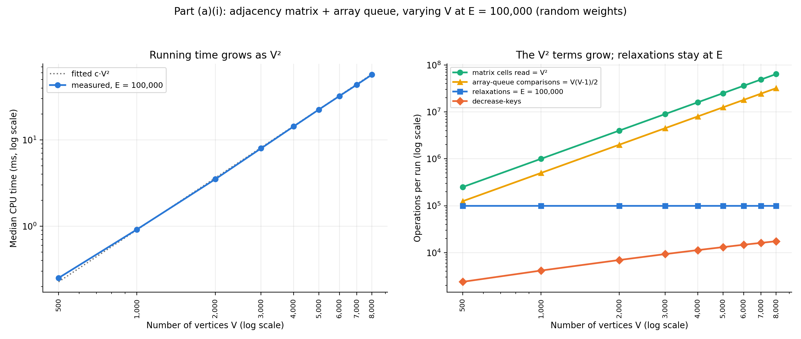
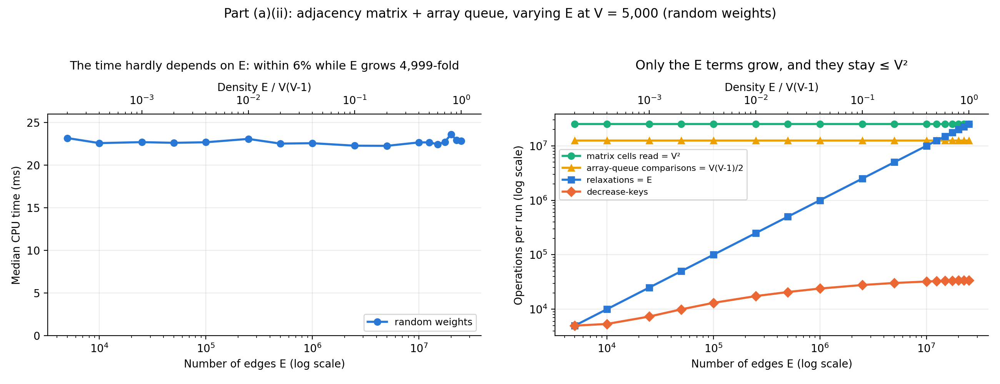
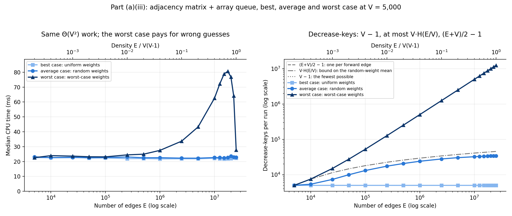
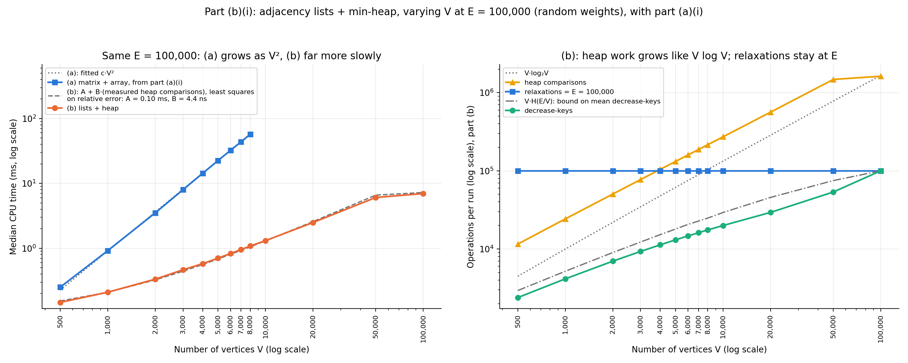
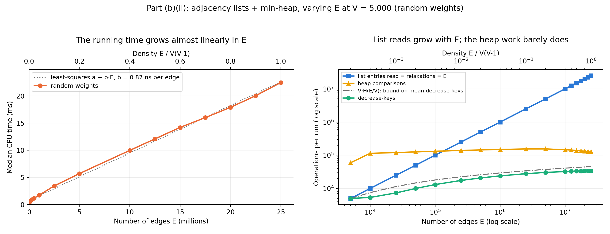
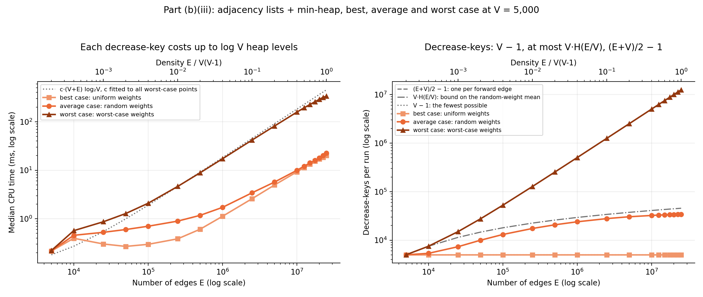
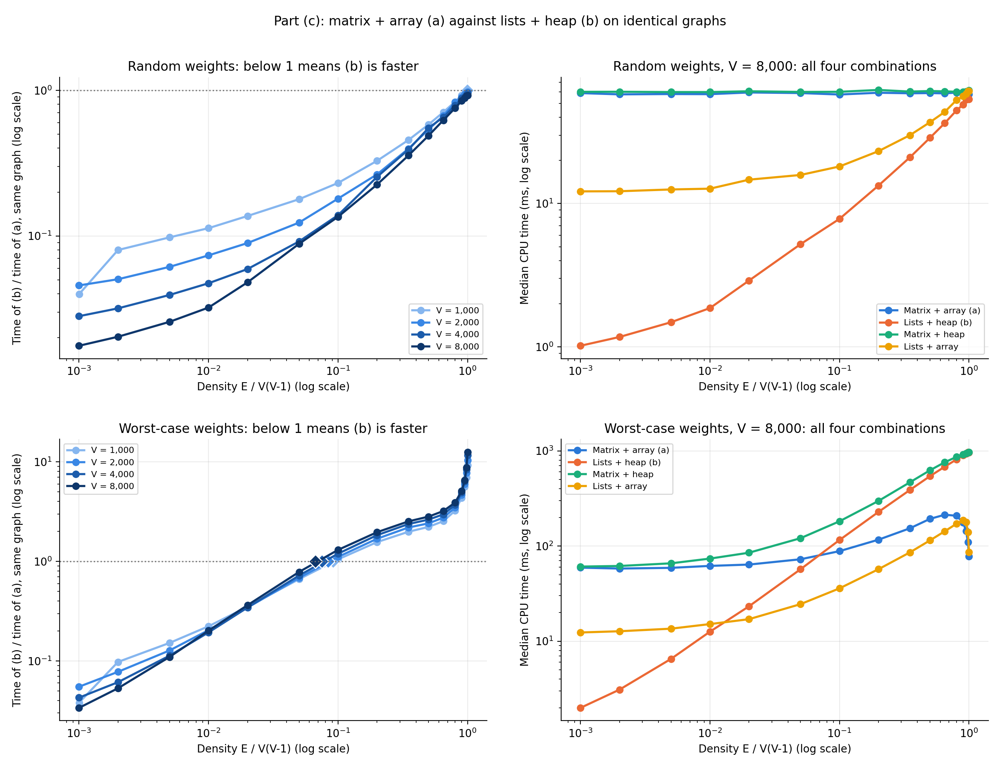
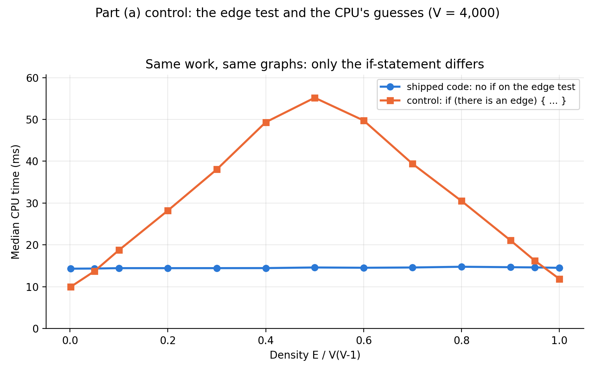

# Dijkstra's Algorithm Experiments

This project implements Dijkstra's algorithm in the two settings of the
assignment and compares them:

- **(a)** the graph in an adjacency matrix, the priority queue in an array;
- **(b)** the graph in an array of adjacency lists, the priority queue in a
  minimizing heap.

The derivations behind every complexity claim below are in
[docs/Theoretical Analysis.md](docs/Theoretical%20Analysis.md).

## Code

| File | Role |
|---|---|
| `java/AdjacencyMatrixGraph.java` | (a) graph: `V × V` matrix of weights, `0` means no edge (lecture 4) |
| `java/ArrayPriorityQueue.java` | (a) queue: unsorted array; `extractMin` scans it, `decreaseKey` is `O(1)` |
| `java/DijkstraMatrixArray.java` | **Part (a)** |
| `java/AdjacencyListGraph.java` | (b) graph: for each vertex, an array of neighbours and one of weights (lecture 4) |
| `java/MinHeapPriorityQueue.java` | (b) queue: 0-based binary min-heap with `Build-Min-Heap`, `Min-Heapify` and the `Enqueue` sift-up of lecture 3, plus an index so `decreaseKey` can find a vertex |
| `java/DijkstraListHeap.java` | **Part (b)** |
| `java/DijkstraMatrixHeap.java`, `java/DijkstraListArray.java` | Part (c): the two mixed combinations, to separate the effect of the graph representation from the effect of the queue |
| `java/MatrixScanControl.java` | Part (a) control (appendix): the matrix scan written with a plain `if` on the edge test |
| `java/ShortestPaths.java` | Result of one run: distances and predecessors |
| `java/GraphGenerator.java` | Random graphs with exact `V` and `E`, in three weightings of the same edges: uniform, random and worst case |
| `java/ShortestPathVerifier.java` | Checks any result against the graph in `O(V + E)` |
| `java/CorrectnessCheck.java` | CLRS worked example, 525 random graphs against Bellman-Ford, generator checks, decrease-key counts of the uniform and worst-case weights |
| `java/ExperimentRunner.java`, `java/Metrics.java` | Experiments; CSV output in `results/` |
| `python/plot_results.py` | Figures in `plots/` |

All four Dijkstra classes follow CLRS (4th ed., Section 22.3), with one added
line that stops at the first unreachable vertex. Every edge of the extracted
vertex is relaxed; a relaxation into an already finished vertex simply fails,
because that vertex's distance is already the smallest.

## Experimental setup

- **Terms.** *Density* is `E / V(V − 1)`, the fraction of all possible edges
  that are present. A *forward edge* is an edge to a vertex that comes later
  on the graph's Hamiltonian cycle (see below), counted from the source; the
  `V − 1` cycle edges themselves are forward edges, except the one that
  closes the cycle.
- **Graphs.** Directed, with exactly `E` edges. Every vertex has out-degree
  `⌊E/V⌋` or `⌈E/V⌉`, with targets drawn uniformly at random and without
  repeats. Every graph contains a random cycle through all vertices (a
  Hamiltonian cycle), so all vertices are reachable from the source, vertex 0.
  Without that, (b) would skip the unreachable vertices while (a) still
  scanned them, which would favour (b) for a reason unrelated to the data
  structures. Each adjacency list is sorted by target, the order in which a
  scan of the matrix row meets them.
- **Three weightings of the same edges, one per case.** None of the
  operation counts (extractions, matrix cells or list entries read,
  relaxations) depends on the weights. The number of decrease-keys does, and
  in the heap so does the cost of each operation.
  - *Uniform weights (best case):* every weight is 1. The first relaxation
    that reaches a vertex already sets its final distance, so exactly
    `V − 1` relaxations lower a key, the fewest possible (proof in the theory
    document). `CorrectnessCheck` confirms the count in all four
    implementations.
  - *Random weights (average case):* uniform integers from 1 to 1,000. On
    average at most about `V · H(E/V)` decrease-keys, where
    `H(k) = 1 + 1/2 + ... + 1/k`.
  - *Worst-case weights:* chosen so that every relaxation of a forward edge
    lowers a key below every other key in the queue, except possibly the key
    of the next vertex on the cycle. That is `(E + V)/2 − 1` decrease-keys
    on average, about `E/2` when `E ≫ V`, and in the heap every one climbs
    to the root or to a child of the root. This is the input behind the
    `E log V` term of (b), which random weights never reach.
    `CorrectnessCheck` confirms that the decrease-key count equals the
    number of forward edges.
- **One change at a time.** Parts (a) and (b) each run three experiments:
  - **(i) vary `V`** with `E` fixed at 100,000, random weights;
  - **(ii) vary `E`** at `V = 5,000`, random weights, over 17 edge counts
    from a single cycle (`E = V`) to the complete graph;
  - **(iii) best, average and worst case:** the sweep of (ii) with all three
    weightings.

  (ii) and (iii) share one CSV file per part, and (ii) is its random-weight
  rows.
- **Seeds.** The base seed is `20261004`. A given `(V, E, trial)` always
  produces the same edges, in every part and in every weighting. Parts (a)
  and (b) therefore run on graphs from the same seeds wherever their
  configurations meet: in (i) up to `V = 8,000`, and in (ii) and (iii). The
  first 10 trials are the same graphs; (b) runs extra trials on small graphs,
  and the two parts are measured in separate runs. With random integer
  weights equal distances occur, and the array queue and the heap break ties
  differently, so random-weight decrease-key counts differ slightly between
  (a) and (b) even on the same graph: at density 0.5 the same 10 graphs give
  32,902.2 decrease-keys on average in (a) and 32,910.5 in (b).
- **Trials.** Each trial of a configuration uses a new graph, so no
  implementation is timed twice in a row on the same graph. Repeating one
  graph lets the CPU learn the run and makes short runs look faster. Each
  configuration gets at least 10 trials; small graphs get more, until 100 ms
  of CPU time has been measured (at most 100 trials).
- **Timing.** Current-thread CPU time of the `run` call alone. Graph
  generation, building the matrix, and verification are not timed. Medians
  are reported. The JVM is warmed up on every implementation first. All runs
  were on an Apple M2 Pro with Java 23 and `-Xmx6g`. Parts (a) and (b) were
  measured on 2026-10-09 on AC power with macOS Low Power Mode off. Part (c)
  comes from an earlier run (2026-10-04) of the same implementations and
  part (c) code; its measurements were not repeated.
- **Counts.** Machine-independent counts are recorded next to the time:
  - *queue comparisons:* key comparisons inside the priority queue;
  - *relaxations:* edges `(u, v)` tested with `d[u] + w(u, v) < d[v]`
    (exactly `E` when every vertex is reachable);
  - *decrease-keys:* relaxations that found a shorter path;
  - *entries read:* matrix cells for (a), list entries for (b).
- **Verification.** Every timed result is checked by `ShortestPathVerifier`.
  In part (c), all four implementations must also agree on every distance.

## Part (a): adjacency matrix + array priority queue

Theory: `Θ(V²)` for any `E`. Each of the `V` extractions scans the whole
queue (`V(V − 1)/2` comparisons in total), and each extracted vertex reads its
whole matrix row (`V²` cells in total). The `E` relaxations and the
decrease-keys cost `O(1)` each, and `E ≤ V(V − 1)`. So best, average and
worst case are all `Θ(V²)`.

### (i) Varying V at E = 100,000

`V` from 500 to 8,000; `E` fixed at 100,000; random weights. 100,000 edges
fit every `V`: at least `V` for the Hamiltonian cycle, and at most
`V(V − 1) = 249,500` at `V = 500`. Only `V` changes, so the density falls
from 0.40 to 0.0016.

| V | Density | Time | Time ÷ V² | Decrease-keys |
|---:|---:|---:|---:|---:|
| 500 | 0.40 | 0.251 ms | 1.00 ns | 2,385 |
| 1,000 | 0.10 | 0.917 ms | 0.92 ns | 4,148 |
| 2,000 | 0.025 | 3.506 ms | 0.88 ns | 6,964 |
| 4,000 | 0.0063 | 14.32 ms | 0.90 ns | 11,321 |
| 8,000 | 0.0016 | 57.15 ms | 0.89 ns | 17,493 |

- The time grows with slope 1.97 on a log-log plot (least squares over all
  nine `V`; 1.99 without `V = 500`), against 2 for `V²`. Time divided by the
  `V²` cells read stays between 0.88 and 1.00 ns, which includes the
  `V(V − 1)/2` queue comparisons.
- In every row, cells read is exactly `V²`, queue comparisons exactly
  `V(V − 1)/2`, and relaxations exactly `E = 100,000`. The decrease-keys
  grow with `V`, from 2,385 to 17,493 (about 0.7-0.8 of `V · H(E/V)`), but each
  costs `O(1)` and they are at most 1% of the `V²` cells read (0.95% at
  `V = 500`, 0.03% at `V = 8,000`). So the growth comes from `V`.



### (ii) Varying E at V = 5,000

`E` from 5,000 (a single cycle) to 24,995,000 (the complete graph); `V`
fixed at 5,000; random weights.

| E | Density | Time | Relaxations | Decrease-keys |
|---:|---:|---:|---:|---:|
| 5,000 | 0.0002 | 23.17 ms | 5,000 | 4,999 |
| 1,000,000 | 0.04 | 22.57 ms | 1,000,000 | 23,980 |
| 12,500,000 | 0.5 | 22.66 ms | 12,500,000 | 32,902 |
| 17,500,000 | 0.7 | 22.70 ms | 17,500,000 | 33,462 |
| 24,995,000 | 1.0 | 22.83 ms | 24,995,000 | 34,043 |

- The time stays between 22.25 and 23.62 ms (within 6.1%) while `E` grows
  4,999-fold, as `Θ(V²)` predicts. A least-squares line through the 17
  times rises by 0.01 ns per edge, against 0.87 ns per edge for (b) in
  (b)(ii).
- Cells read (25,000,000 = `V²`) and queue comparisons
  (12,497,500 = `V(V − 1)/2`) are the same in every row. Only the
  relaxations (`= E`) and the decrease-keys grow with `E`, and even on the
  complete graph the relaxations stay below `V²` and only 34,043 of them
  lower a key.



### (iii) Best, average and worst case at V = 5,000

The sweep of (ii) with uniform, random and worst-case weights.

| E | Density | Time, uniform | Time, random | Time, worst case | Decrease-keys, uniform | Decrease-keys, random | Decrease-keys, worst case |
|---:|---:|---:|---:|---:|---:|---:|---:|
| 5,000 | 0.0002 | 22.54 ms | 23.17 ms | 22.59 ms | 4,999 | 4,999 | 4,999 |
| 1,000,000 | 0.04 | 21.80 ms | 22.57 ms | 27.50 ms | 4,999 | 23,980 | 502,410 |
| 12,500,000 | 0.5 | 21.96 ms | 22.66 ms | 72.17 ms | 4,999 | 32,902 | 6,251,326 |
| 17,500,000 | 0.7 | 21.92 ms | 22.70 ms | 80.60 ms | 4,999 | 33,462 | 8,750,640 |
| 24,995,000 | 1.0 | 22.39 ms | 22.83 ms | 27.74 ms | 4,999 | 34,043 | 12,497,500 |

- **The decrease-keys follow the theory.** Uniform weights give exactly
  4,999 = `V − 1` in every row. Random weights give 4,999 to 34,043, at most
  `V · H(E/V)` (0.64-0.82 of it for `E > V`). Worst-case weights give one
  per forward edge, `(E + V)/2 − 1` to within 0.1%: 7,502 at `E = 2V`,
  1.5 times `E/2`, and about `E/2` once `E ≫ V`.
- **Best and average case take nearly the same time.** Relative to the
  random-weight time at the same `E`, uniform weights take between 6.8% less
  and 1.1% more, 2.3% less on average. Both lower few keys, at `O(1)` each,
  so the `V²` scan decides.
- **The worst case is not flat.** It stays within 6.2% of random weights up
  to `E = 100,000`, rises to a peak of 80.60 ms at density 0.7, 3.55 times
  the random-weight time, and falls back to 27.74 ms on the complete graph,
  although that graph has the most decrease-keys.

**Why the worst case has a bump.** The extra work itself is cheap: on the
complete graph, 12,463,457 more decrease-keys than with random weights add
4.90 ms, 0.39 ns each. At density 0.5 the extra decrease-keys cost 8.0 ns
each. The difference is the relaxation test `if (candidate < d[v])`. The CPU
guesses the outcome of every `if` before it is known, and throws work away
when the guess is wrong (see the [appendix](#appendix-why-the-matrix-scan-has-no-if-statement)).

- In the row of the `i`-th extracted vertex, a cell passes the test when it
  holds an edge (probability `d`, the density) to a vertex that is not yet
  finished (fraction `(V − i)/V`). So the pass rate `p = d(V − i)/V` falls
  from `d` to 0 during the run. When the passes are scattered at random, the
  best guess is wrong in about `min(p, 1 − p)` of the cells. Averaged over
  the run that is `d/2` up to `d = 0.5`, with a peak of 0.29 at
  `d = 1/√2 ≈ 0.71`.
- From density 0.1 to 0.8 the extra time over random weights follows this
  shape, at 7.4-9.1 ns per predicted wrong guess; at 0.8 it is already 7%
  below the model. Below density 0.1 the extra time is under 5 ms, too
  little for a stable estimate per wrong guess.

  | Density | 0.1 | 0.2 | 0.4 | 0.5 | 0.6 | 0.7 | 0.8 | 0.9 | 1.0 |
  |---|---:|---:|---:|---:|---:|---:|---:|---:|---:|
  | Extra time over random weights | 11.4 ms | 21.0 ms | 39.9 ms | 49.5 ms | 56.4 ms | 57.9 ms | 53.2 ms | 41.2 ms | 4.9 ms |
  | Measured, relative to density 0.5 | 0.23 | 0.42 | 0.81 | 1 | 1.14 | 1.17 | 1.07 | 0.83 | 0.10 |
  | Model `min(p, 1 − p)`, relative to density 0.5 | 0.20 | 0.40 | 0.80 | 1 | 1.13 | 1.17 | 1.15 | 1.09 | 1.00 |

- At densities 0.9 and 1.0 the model predicts far too much. The most likely
  reason, which was not measured directly, is that the passes are no longer
  scattered at random. On the complete graph a cell passes exactly when its
  vertex is unfinished, so the pattern of passes in each row is the previous
  row's with one vertex removed. The CPU guesses from the recent history of
  outcomes, so it most likely learns this repeating pattern, and the extra
  time falls to 4.9 ms. At density 0.9 the pattern is mostly the same from
  row to row, with about 10% random holes, and the extra time (41.2 ms) lies
  between the two cases (53.9 ms predicted). At density 0.5 the passes are a
  fresh random half of the unfinished vertices in every row, which cannot be
  learned.
- This changes the constant, not the growth: each cell adds at most one
  wrong guess, so the worst case is still `Θ(V²)`.



## Part (b): adjacency lists + min-heap

Theory: `O((V + E) log V)`. `Build-Min-Heap` is `O(V)`, the `V`
extractions are `O(log V)` each, every list entry is read once, and each of
at most `E` decrease-keys climbs at most `log V` levels.

### (i) Varying V at E = 100,000

`V` from 500 to 100,000; `E` fixed at 100,000, as in (a)(i); random weights.
`V` cannot exceed `E`, because the Hamiltonian cycle needs `E ≥ V`; at
`V = 100,000` every vertex has out-degree 1 and the graph is the cycle alone.
The matrix of (a) would need `4V²` bytes, 40 GB at `V = 100,000`, which is
why (a)(i) stops at 8,000 (256 MB). Up to 8,000 the two parts use graphs from
the same seeds (the first 10 trials are the same graphs; (b) runs up to 100
trials on these small graphs), measured in separate runs.

| V | E / V | Time (b) | Time (a), from (a)(i) | (a) ÷ (b) | Heap comparisons | Decrease-keys |
|---:|---:|---:|---:|---:|---:|---:|
| 500 | 200 | 0.146 ms | 0.251 ms | 1.7 | 11,552 | 2,388 |
| 1,000 | 100 | 0.210 ms | 0.917 ms | 4.4 | 24,245 | 4,149 |
| 2,000 | 50 | 0.333 ms | 3.506 ms | 10.5 | 50,420 | 6,975 |
| 3,000 | 33.3 | 0.465 ms | 7.984 ms | 17.2 | 77,239 | 9,300 |
| 4,000 | 25 | 0.578 ms | 14.32 ms | 24.8 | 104,338 | 11,300 |
| 5,000 | 20 | 0.703 ms | 22.49 ms | 32.0 | 131,830 | 13,092 |
| 6,000 | 16.7 | 0.828 ms | 32.28 ms | 39.0 | 159,662 | 14,693 |
| 7,000 | 14.3 | 0.955 ms | 43.71 ms | 45.8 | 187,536 | 16,158 |
| 8,000 | 12.5 | 1.080 ms | 57.15 ms | 52.9 | 215,541 | 17,519 |
| 10,000 | 10 | 1.308 ms | | | 272,206 | 19,953 |
| 20,000 | 5 | 2.490 ms | | | 562,571 | 29,375 |
| 50,000 | 2 | 6.060 ms | | | 1,476,574 | 53,556 |
| 100,000 | 1 | 6.963 ms | | | 1,622,836 | 99,999 |

- **Two parts of the work.** Reading and relaxing the `E` list entries costs
  the same in every row (relaxations are exactly 100,000 in every row). The
  heap work grows with `V`: heap comparisons are 1.9 to 2.6 times
  `V log₂V` up to `V = 50,000`. When `V ≪ E` the list reads dominate and the
  curve is flatter: its log-log slope is 0.52 between `V = 500` and 1,000. As
  `V` grows the `V` extractions at `O(log V)` each take over, and the slope
  rises to 0.86-0.97 between 4,000 and 50,000.
- **A two-term model fits every row.** A least-squares fit (on relative
  error) of time `= A + B · (heap comparisons)` gives `A = 0.103` ms, about
  1.0 ns per list entry, and `B = 4.39` ns per heap comparison. It is within
  8% of every measured time (measured ÷ fitted = 0.92-1.05). `A` is 70% of
  the time at `V = 500` and 1.5% at `V = 100,000`. A fit of
  `A + B · V log₂V` does worse (0.61-1.27), because the heap work per
  vertex depends on `E/V`, as the next point shows.
- **The last point, `V = E`, is cheap.** The time grows only 15% from
  `V = 50,000` to 100,000. With the cycle alone, only one vertex at a time
  has a finite key, so each extraction moves a key `∞` to the root, where
  its children are `∞` too and `Min-Heapify` stops after two comparisons;
  only the decrease-keys climb. Heap comparisons per vertex fall from 29.5
  to 16.2 (`log₂ 100,000 = 16.6`).
- **Decrease-keys** grow from 2,388 to 53,556 up to `V = 50,000`, 0.64-0.81
  of the bound `V · H(E/V)`, and are exactly `V − 1 = 99,999` at `V = E`,
  where every vertex has one in-edge. They are part of the heap comparisons
  in the model.
- **Against (a)(i).** On the same `E`, (a) takes 1.7 times as long as (b) at
  `V = 500` and 52.9 times as long at `V = 8,000`. Over that range (a) grows
  228-fold, close to the 256-fold growth of `V²`, and (b) 7.4-fold. The
  decrease-key counts of the two differ slightly (17,493 in (a)(i) and
  17,519 in (b)(i) at `V = 8,000`), because (b) averages over more trials and
  because the two queues break ties between equal distances differently.



### (ii) Varying E at V = 5,000

`E` from 5,000 to 24,995,000; `V` fixed at 5,000; random weights; graphs
from the same seeds as (a)(ii).

| E | Density | Time | Heap comparisons | Decrease-keys | `V · H(E/V)` |
|---:|---:|---:|---:|---:|---:|
| 5,000 | 0.0002 | 0.219 ms | 59,557 | 4,999 | 5,000 |
| 1,000,000 | 0.04 | 1.719 ms | 149,683 | 23,921 | 29,390 |
| 12,500,000 | 0.5 | 12.09 ms | 143,045 | 32,910 | 42,007 |
| 17,500,000 | 0.7 | 16.01 ms | 135,749 | 33,492 | 43,689 |
| 24,995,000 | 1.0 | 22.46 ms | 127,519 | 34,022 | 45,472 |

- **The time grows almost linearly in `E`,** from 0.219 to 22.46 ms. A
  least-squares line `a + b · E` has `b = 0.87` ns per edge
  (`a = 0.75` ms) and stays within 0.58 ms of every point.
- **The heap work hardly grows.** From `E = 10,000` on, the heap comparisons
  stay between 114,313 and 154,961 while `E` grows 2,500-fold. The
  decrease-keys stay below `V · H(E/V)`: on the complete graph only 34,022
  of the 25 million relaxations lower a key (0.14%), against the bound
  45,472. So the time is the `Θ(E)` cost of reading the lists plus a heap
  term that barely depends on `E`, as the theory for random weights
  predicts: `Θ(E) + O(V log V · (1 + log(E/V)))`.



### (iii) Best, average and worst case at V = 5,000

The sweep of (ii) with uniform, random and worst-case weights, on graphs
from the same seeds as (a)(iii).

| E | Density | Time, uniform | Time, random | Time, worst case | Decrease-keys, uniform | Decrease-keys, random | Decrease-keys, worst case |
|---:|---:|---:|---:|---:|---:|---:|---:|
| 5,000 | 0.0002 | 0.217 ms | 0.219 ms | 0.222 ms | 4,999 | 4,999 | 4,999 |
| 1,000,000 | 0.04 | 1.125 ms | 1.719 ms | 17.24 ms | 4,999 | 23,921 | 502,410 |
| 12,500,000 | 0.5 | 11.32 ms | 12.09 ms | 192.9 ms | 4,999 | 32,910 | 6,251,326 |
| 17,500,000 | 0.7 | 15.32 ms | 16.01 ms | 257.6 ms | 4,999 | 33,492 | 8,750,640 |
| 24,995,000 | 1.0 | 19.98 ms | 22.46 ms | 336.1 ms | 4,999 | 34,022 | 12,497,500 |

- **At fixed `V` all three grow about linearly in `E`, at very different
  rates.** `(V + E) log V` is linear in `E` when `V` is fixed.
  Least-squares lines over the 17 edge counts give 0.82 ns per edge
  (uniform), 0.87 ns (random) and 14.1 ns (worst case). On the complete
  graph the worst case takes 15.0 times as long as random weights.
- **Best case.** Exactly 4,999 decrease-keys at every `E`, and the fastest
  of the three at every `E`. Below `E = 1,000,000` it needs as little as
  0.42 of the random-weight time (0.298 against 0.703 ms at
  `E = 100,000`). Besides lowering fewer keys, equal weights give many
  equal keys, and `Min-Heapify` stops at the first child whose key is not
  smaller: at `E = 1,000,000` the uniform runs make 26,492 heap comparisons,
  random weights 149,683. On dense graphs reading the lists dominates both:
  19.98 against 22.46 ms on the complete graph.
- **The one bump in the best case,** at `E = 10,000` (0.397 ms, against
  0.217 ms at `E = 5,000` and 0.270 ms at `E = 50,000`), has the most heap
  comparisons (105,303). With two edges per vertex the search spreads over
  many levels, and most extractions move a vertex with key `∞` from the
  bottom of the heap to the root, from where it sinks past every finite
  key. With one edge per vertex there is only one finite key at a time (as
  at `V = E` in (b)(i)); with ten or more, most vertices soon share the same
  few keys.
- **Worst case: each decrease-key climbs most of the heap.** On the complete
  graph the worst case makes 132,808,399 heap comparisons, 132,680,880 more
  than random weights for 12,463,478 more decrease-keys: 10.6 comparisons
  per decrease-key. A climb of `L` levels makes `L` comparisons if it
  reaches the root and `L + 1` if it stops below it. It stops one level
  below the root when the next cycle vertex already holds the root, which
  happens for the decrease-keys that come after the cycle edge in the
  vertex's list: about half, because lists are sorted by vertex number, not
  by position on the cycle. So each decrease-key climbs about 10.1 levels,
  out of at most 12 (`log₂ 5,000 = 12.3`). Part (c)'s complete graphs show
  the same climb growing with `log V`: 8.39 to 11.32 comparisons per
  decrease-key from `V = 1,000` to 8,000, `log₂V − 1.6` at every size.
- **Against the bound.** With `c` fitted to all 17 worst-case points,
  measured time ÷ `c · (V + E) log₂V` falls from 1.10 at `E = 100,000` to
  0.74 on the complete graph: the time grows like the `O((V + E) log V)`
  bound, a little more slowly than it over this range. Below
  `E = 100,000` the curve underestimates, by up to 2.1 times at
  `E = 10,000` (1.22 at 5,000, 1.60 at 25,000, 1.29 at 50,000). There the
  `V` extractions dominate, and `Min-Heapify` makes up to two comparisons
  per heap level, against one per level for a decrease-key, while the
  formula weighs `V` and `E` the same.



## Part (c): which implementation is better, and when

All four combinations ran on the same graphs, over `V` = 1,000 to 8,000 and
16 densities from 0.001 to 1, in a shuffled order in each trial. The table
gives the median over trials of time(b) ÷ time(a) on the same graph: below 1
means (b) is faster.

| Weights | V | Density 0.001 | 0.1 | 0.5 | 1.0 |
|---|---:|---:|---:|---:|---:|
| random | 1,000 | 0.040 | 0.231 | 0.582 | 1.005 |
| random | 2,000 | 0.046 | 0.180 | 0.538 | 0.973 |
| random | 4,000 | 0.028 | 0.139 | 0.551 | 0.959 |
| random | 8,000 | 0.018 | 0.135 | 0.489 | 0.925 |
| worst case | 1,000 | 0.038 | 1.050 | 2.224 | 9.235 |
| worst case | 2,000 | 0.055 | 1.111 | 2.413 | 10.358 |
| worst case | 4,000 | 0.043 | 1.196 | 2.635 | 11.633 |
| worst case | 8,000 | 0.034 | 1.306 | 2.820 | 12.564 |

With worst-case weights, (b) stops being faster between the grid densities
0.05 and 0.1 at every `V`. The last two columns interpolate inside that
bracket:

| V | (b)/(a) at 0.05 | (b)/(a) at 0.1 | Crossover density | Crossover × `log₂V` |
|---:|---:|---:|---:|---:|
| 1,000 | 0.664 | 1.050 | 0.091 | 0.91 |
| 2,000 | 0.685 | 1.111 | 0.084 | 0.92 |
| 4,000 | 0.722 | 1.196 | 0.075 | 0.90 |
| 8,000 | 0.784 | 1.306 | 0.067 | 0.86 |

With random weights, (b) is faster at every density below 1 for every `V`.
On the complete graph the two tie at `V = 1,000` (1.005), and (b) is 3-8%
faster for the larger `V`.



### Conclusions

- **Sparse graphs: (b), by a wide margin.** At density 0.001, (b) is 18 to
  57 times faster; at `V = 8,000` it is 57 times faster with random weights
  and 30 times with worst-case weights. Parts (a) and (b), on graphs from
  the same seeds but measured in separate runs, agree: at `V = 5,000` with
  random weights (a) takes 105.8 times as long as (b) on a single cycle
  (`E = V`) and 37.6 times as long at `E = 50,000`, and at `E = 100,000` it
  takes 52.9 times as long at `V = 8,000`. (a) reads `V²` cells
  and scans `V(V − 1)/2` queue entries whatever the graph looks like; (b)
  only touches what is there.
- **Dense graphs where few relaxations lower a key (random weights): (b),
  by a margin that shrinks as the graph fills up.** (b) reads the `E` list
  entries, (a) all `V²` matrix cells. At density 0.5, (b) takes 0.49-0.58 of
  the time of (a); on the complete graph the two are level (0.925-1.005). The
  same holds on the `V = 5,000` sweeps of parts (a) and (b): (a) takes 1.88
  times as long as (b) at density 0.5 and 1.02 times on the complete graph.
  The `log V` factor of (b) never shows, because at density 0.5 and above at
  most 1.1% of relaxations call `decreaseKey` (1.1% at `V = 1,000`, 0.17% at
  `V = 8,000`).
- **Dense graphs where most relaxations lower a key (worst case): (a), by up
  to 12.6 times at V = 8,000 on a complete graph.** Here the difference
  between `O(1)` and `O(log V)` per `decreaseKey` decides the result. The
  crossover lies between densities 0.05 and 0.1 (interpolated 0.067-0.091)
  and moves lower as `V` grows: at both grid points the ratio rises with
  `V`. While `V` grows 8-fold, the interpolated crossover falls by 27%,
  close to the 23% fall of the theoretical break-even density `1 / log V`
  (from `E ≈ V² / log V`). Parts (a)(iii) and (b)(iii) agree at
  `V = 5,000`: with worst-case weights (b) takes 0.63 of the time of (a) at
  density 0.04, 1.24 times as long at 0.1, and 12.1 times as long on the
  complete graph.
- **Which component matters** (`V = 8,000`, median times):

  | | Matrix + array (a) | Matrix + heap | Lists + array | Lists + heap (b) |
  |---|---:|---:|---:|---:|
  | Random, density 0.001 | 59.0 ms | 60.2 ms | 12.2 ms | 1.0 ms |
  | Worst case, density 1.0 | 77.5 ms | 971.2 ms | 86.2 ms | 962.1 ms |

  On sparse graphs, both parts of (a) cost something: switching only to
  lists still leaves 12.2 ms of array scanning, and switching only to a heap
  leaves the 60 ms matrix scan. Only (b), which changes both, gets down to
  1 ms. On the worst-case complete graph the queue alone decides: with or
  without the matrix, the heap versions take about 960-970 ms and the array
  versions 77-86 ms.
- **Memory.** The matrix needs `4V²` bytes whatever `E` is; the lists need
  about `8E + 40V` bytes.

  | Graph | Matrix | Lists |
  |---|---:|---:|
  | `V = 8,000`, density 0.001 | 256 MB | 0.8 MB |
  | `V = 8,000`, density 0.5 | 256 MB | 256 MB |
  | `V = 8,000`, complete | 256 MB | 512 MB |
  | `V = 100,000`, `E = 100,000` | 40 GB | 4.8 MB |

  The lists use less memory below density 0.5 and twice as much as the
  matrix on a complete graph, because each edge stores its target as well as
  its weight, while a matrix cell stores only the weight. Above a few tens of
  thousands of vertices the matrix does not fit in memory at all.
- **Reachability.** If the source reaches only a small part of the graph,
  (a) still reads `V` cells for every vertex it extracts, while (b) only
  touches the reachable part after its `O(V)` `Build-Min-Heap`.

In short: use (b) unless the graph is dense and most relaxations are expected
to lower a distance, or unless a matrix is needed anyway for `O(1)` edge
lookups and memory allows it.

## Run

Run these commands from the `project-2` folder. The plots need `matplotlib`.

```bash
javac -d out java/*.java
```

```bash
java -cp out CorrectnessCheck
```

```bash
java -Xmx6g -cp out ExperimentRunner results
```

```bash
python3 python/plot_results.py results
```

`ExperimentRunner` takes an optional second argument naming the parts to
run, so one part can be rerun without overwriting results the report
already quotes. The committed results of parts (a) and (b) come from
`java -Xmx6g -cp out ExperimentRunner results a` and `... results b`, which
take about 1.5 minutes each; part (c), the longest, comes from an earlier
`... results c` run (2026-10-04). CSV data is written to `results/` and figures to `plots/`.

## Appendix: why the matrix scan has no if-statement

This is backup material for part (a): it explains a choice in the code,
not the algorithm, and it is the same effect that makes the worst case of
(a)(iii) slower at middle densities.

The textbook loop reads "for each `v` adjacent to `u`", that is
`if (row[v] != NO_EDGE) { relax }`. The CPU guesses the outcome of every
`if` before it is known, and throws work away when the guess is wrong. In a
random row of density 0.5, "is there an edge here?" is a coin flip.

`DijkstraMatrixArray` therefore treats a missing edge as weight `∞` (the CLRS
convention for weight matrices) and computes `d[u] + w` or `∞` with a bit
mask (`AdjacencyMatrixGraph.distanceThrough`). The only `if` left is the
relaxation test, which almost always fails on random weights. The control
(`MatrixScanControl`) runs both versions on the same graphs at `V = 4,000`:

| Density | 0.001 | 0.1 | 0.3 | 0.5 | 0.7 | 0.9 | 1.0 |
|---|---:|---:|---:|---:|---:|---:|---:|
| No `if` (shipped) | 14.3 ms | 14.5 ms | 14.5 ms | 14.6 ms | 14.6 ms | 14.7 ms | 14.5 ms |
| Separate `if` (control) | 10.0 ms | 18.8 ms | 38.1 ms | 55.2 ms | 39.4 ms | 21.1 ms | 11.9 ms |

- Both versions make the same relaxations and decrease-keys. The control
  skips an empty cell after one test, while the shipped code computes a mask
  and compares in every cell. So where the edge test is easy to guess, the
  control is faster: 10.0 against 14.3 ms at density 0.001.
- At density 0.5 the control's wrong guesses make it 3.8 times slower. Its
  curve is nearly symmetric about 0.5 (38.1 ms at 0.3, 39.4 ms at 0.7): an
  edge is present with probability `d` in every row, so the share of wrong
  guesses is `min(d, 1 − d)`. Without the change, measured time would rise and fall
  with `E` for a reason that has nothing to do with the algorithm. That
  would also distort part (c), where most comparisons happen at middle
  densities.
- The price is that on the sparsest graphs the shipped (a) is about 1.4 times
  slower than the textbook loop, so part (c)'s sparse-graph margins of (b)
  are about 1.4 times larger than they would be against the textbook loop.


