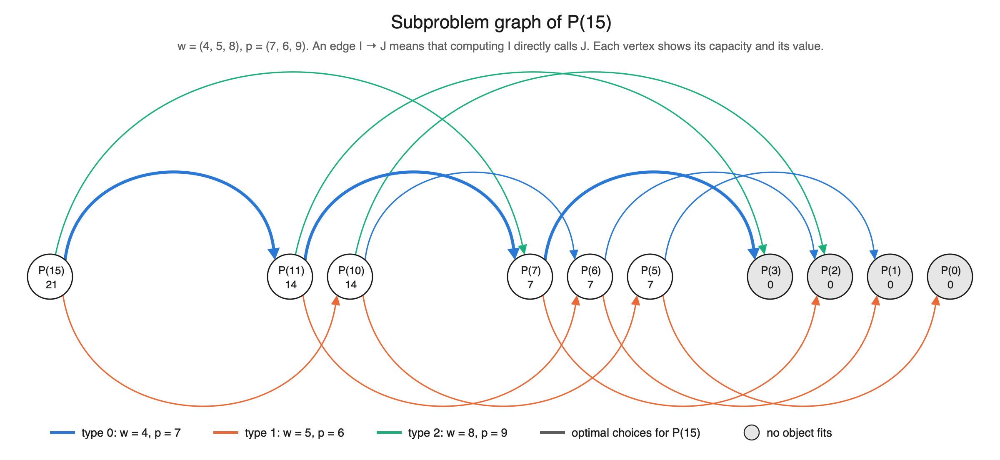

# Knapsack with Unlimited Supplies

This project solves the knapsack problem of the assignment by dynamic
programming. The knapsack has capacity `C`, and there are `n` object types
with weights `wᵢ` and profits `pᵢ` and an unlimited supply of each type.
`P(C)` is the largest total profit of any set of objects that fits.

The proofs behind the claims below are in
[docs/Theoretical Analysis.md](docs/Theoretical%20Analysis.md).

## Code

| File | Role |
|---|---|
| `java/UnboundedKnapsack.java` | **Part (3)**: the bottom-up algorithm, and the vertices of the subproblem graph |
| `java/KnapsackSolution.java` | Result of one run: the table of `P(c)` and one optimal packing |
| `java/ExperimentRunner.java` | **Part (4)**: prints the running results; CSV output in `results/` |
| `java/CorrectnessCheck.java` | Hand-worked tables, the graph of `P(15)`, and 5,400 random instances against exhaustive search |
| `python/plot_subproblem_graph.py` | **Part (2)**: figure in `plots/` |

## Part (1): recursive definition

```text
P(C) = 0                                  if wᵢ > C for every i
P(C) = max { pᵢ + P(C − wᵢ) : wᵢ ≤ C }    otherwise
```

Choose any object of an optimal packing: the rest must be an optimal packing
of the remaining capacity. A subproblem is only a capacity, because taking an
object leaves all `n` types available. This is why `P` needs one parameter
here, where the 0/1 knapsack of lecture 10 needs two, `P(C, j)`.

The structure is that of coin changing in lecture 10, with `max` for `min` and
`pᵢ` for `1`. There is one difference: the lecture assumes the smallest
denomination is 1, so every amount can be changed, whereas here the first line
applies to every capacity below the smallest weight, not only to `C = 0`.

## Part (2): subproblem graph of P(15)

With `w = (4, 5, 8)` and `p = (7, 6, 9)`. As defined in lecture 10, an edge
`(I, J)` means that computing `I` makes a direct recursive call on `J`.



The graph has 10 vertices and 15 edges:

| Vertex | Direct calls | Value |
|---|---|---|
| `P(15)` | `P(11)`, `P(10)`, `P(7)` | `max(7 + 14, 6 + 14, 9 + 7) = 21` |
| `P(11)` | `P(7)`, `P(6)`, `P(3)` | `max(7 + 7, 6 + 7, 9 + 0) = 14` |
| `P(10)` | `P(6)`, `P(5)`, `P(2)` | `max(7 + 7, 6 + 7, 9 + 0) = 14` |
| `P(7)` | `P(3)`, `P(2)` | `max(7 + 0, 6 + 0) = 7` |
| `P(6)` | `P(2)`, `P(1)` | `max(7 + 0, 6 + 0) = 7` |
| `P(5)` | `P(1)`, `P(0)` | `max(7 + 0, 6 + 0) = 7` |
| `P(3)`, `P(2)`, `P(1)`, `P(0)` | none, no object fits | `0` |

The capacities 14, 13, 12, 9, 8 and 4 are not vertices, because no combination
of the weights adds up to 1, 2, 3, 6, 7 or 11. The bottom-up algorithm fills
their array entries anyway.

## Part (3): bottom-up algorithm

```text
MaxProfit(w[0..n-1], p[0..n-1], C):
    P[0] = 0
    for c = 1 to C:
        P[c] = 0
        for i = 0 to n - 1:
            if w[i] ≤ c and p[i] + P[c - w[i]] > P[c]:
                P[c] = p[i] + P[c - w[i]]
    return P[C]
```

Every edge of the subproblem graph leads to a smaller capacity, so filling the
array from 0 upwards has each subproblem's dependencies ready when it is
computed. The running time is `Θ(nC)` and the space `Θ(C)`. The code also
records the type chosen at each capacity, which gives an optimal packing.

## Part (4): running results

Each row shows `P(C)` and the candidate of every type that fits. `taken` is the
type that gives `P(C)`; on a tie, the lowest type.

### (a) P(16) with the weights and profits of part (2)

```text
Part (4a): P(16)
  w = [4, 5, 8]
  p = [7, 6, 9]

    C  P(C)  7+P(C-4)  6+P(C-5)  9+P(C-8)  taken
    0     0         -         -         -      -
    1     0         -         -         -      -
    2     0         -         -         -      -
    3     0         -         -         -      -
    4     7         7         -         -      0
    5     7         7         6         -      0
    6     7         7         6         -      0
    7     7         7         6         -      0
    8    14        14         6         9      0
    9    14        14        13         9      0
   10    14        14        13         9      0
   11    14        14        13         9      0
   12    21        21        13        16      0
   13    21        21        20        16      0
   14    21        21        20        16      0
   15    21        21        20        16      0
   16    28        28        20        23      0

  P(16) = 28
  optimal packing: 4 x type 0 (total weight 16, total profit 28)
```

### (b) P(12) with w = (5, 6, 7) and p = (7, 6, 9)

```text
Part (4b): P(12)
  w = [5, 6, 7]
  p = [7, 6, 9]

    C  P(C)  7+P(C-5)  6+P(C-6)  9+P(C-7)  taken
    0     0         -         -         -      -
    1     0         -         -         -      -
    2     0         -         -         -      -
    3     0         -         -         -      -
    4     0         -         -         -      -
    5     7         7         -         -      0
    6     7         7         6         -      0
    7     9         7         6         9      2
    8     9         7         6         9      2
    9     9         7         6         9      2
   10    14        14         6         9      0
   11    14        14        13         9      0
   12    16        16        13        16      0

  P(12) = 16
  optimal packing: 1 x type 0 + 1 x type 2 (total weight 12, total profit 16)
```

Taking the best profit-to-weight ratio first would also reach 28 in (a), but
not 16 in (b): it takes two objects of type 0 (ratio 1.4) for a profit of 14,
and the remaining capacity of 2 fits nothing.

The same tables are in `results/part_4a_P16.csv` and
`results/part_4b_P12.csv`.

## Correctness check

`CorrectnessCheck` compares both tables with versions worked out by hand, and
checks the vertices and the edge count of the graph of `P(15)`. It then runs
5,400 random instances against an exhaustive search over every multiset of
objects, which shares no code with the recurrence, at every capacity from 0 to
`C`, and confirms that each reported packing fits and earns `P(C)`.

## Run

Run these commands from the `project-3` folder. The figure needs only Python's
standard library: the script writes the SVG, and on macOS converts it to PNG
with `sips`.

```bash
javac -d out java/*.java
```

```bash
java -cp out CorrectnessCheck
```

```bash
java -cp out ExperimentRunner results
```

```bash
python3 python/plot_subproblem_graph.py results
```

CSV data is written to `results/` and the figure to `plots/`.
